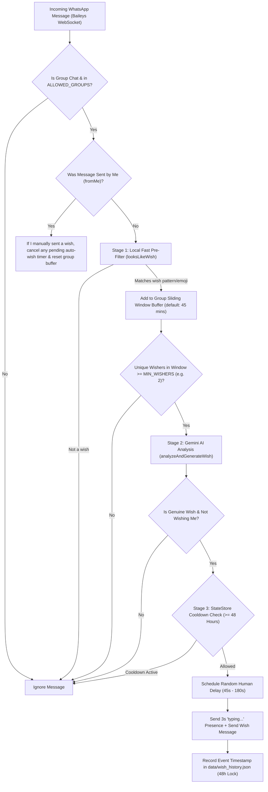

# WhatsApp Group Birthday & Festival Auto-Wish Bot 🎂🎉

A lightweight, 24/7 WhatsApp group auto-reply bot built with **Node.js**, **`@whiskeysockets/baileys`**, and **Google Gemini (`gemini-2.5-flash`)**.

When multiple people in a whitelisted WhatsApp group start wishing someone a Happy Birthday, Happy Anniversary, or celebrating a festival (e.g., Diwali, Eid, Christmas, Holi, New Year), this bot detects the trend, verifies the occasion with Gemini AI, waits a natural human-like delay, and sends a warm wish on your behalf—while enforcing a strict **2-day (48-hour) cooldown** so it never repeats itself.

---

## How the Code Works (Architecture & Pipeline)



### Step-by-Step Execution Flow

1. **Persistent WhatsApp Multi-Device Connection (`src/bot.js`)**
   - Uses `@whiskeysockets/baileys` to connect directly to WhatsApp's WebSocket servers as a linked device (no headless Chrome browser needed, ~40MB RAM).
   - Saves your encrypted WhatsApp session credentials inside `data/auth_info_baileys/` so restarts or redeployments never require re-linking.
   - Supports linking via either a **QR Code** in the terminal or an **8-character Phone Pairing Code** (`PAIRING_PHONE_NUMBER` env var) for easy setup from cloud logs.

2. **Group Whitelist & Manual Override (`src/bot.js`)**
   - Every incoming message is checked against `ALLOWED_GROUPS` (which matches either the group's human-readable name like `"Family"` or its WhatsApp JID like `1203630...@g.us`).
   - **Manual Override**: If *you* send a wish manually from your phone (`msg.key.fromMe === true`), the bot immediately cancels any pending countdown timer for that group and clears the buffer so it never sends a duplicate wish after you already replied.

3. **Stage 1: Fast Local Pre-Filter & Sliding Window (`src/wishDetector.js`)**
   - Rather than calling the Gemini API on every single group chat message, `looksLikeWish()` runs a zero-latency local check for birthday keywords (`happy birthday`, `hbd`, `bday`, `many happy returns`, `janamdin`), festival greetings (`happy diwali`, `eid mubarak`, `merry christmas`, `happy holi`, `happy navratri`, `happy new year`, etc.), and celebratory emojis (`🎂`, `🥳`, `🎉`, `🪔`).
   - Matching messages are stored in an in-memory per-group sliding window (`WINDOW_MINUTES`, default `45` minutes).
   - `WishTracker` counts the number of **unique senders** who have wished in that group during the window. Once `uniqueWisherCount >= MIN_WISHERS` (default `2`), it triggers Stage 2.

4. **Stage 2: Gemini AI Verification & Personalized Reply (`src/geminiService.js`)**
   - Sends the batch of recent wish messages from that group (along with sender names and `@mentioned` JIDs) to `gemini-2.5-flash` using a strict JSON schema:
     - **Self-Wish Protection**: Checks if group members are tagging or wishing *you* (the bot owner). If it's your own birthday, it blocks auto-replying!
     - **Canonical Event Key (`eventKey`)**: Extracts a normalized key such as `birthday:rahul`, `birthday:919876543210@s.whatsapp.net`, or `festival:diwali`.
     - **Tone-Matched Wish (`replyText`)**: Generates a short, natural wish matching the language and vibe of the group, tagging the birthday person (`@mention`) if others tagged them.
   - Includes an automatic rule-based template fallback if `GEMINI_API_KEY` is not set.

5. **Stage 3: Persistent 2-Day Cooldown (`src/stateStore.js`)**
   - Before scheduling a message, `StateStore.canWish(groupId, eventKey)` checks `data/wish_history.json`.
   - Enforces at least a **48-hour (2-day) cooldown** (`COOLDOWN_HOURS=48`) per `(groupId, eventKey)` so the bot never wishes for the same person or festival twice within 2 days.
   - Optionally also supports `GROUP_GLOBAL_COOLDOWN_HOURS=48` to enforce a 2-day minimum gap between *any* two auto-wishes in the same group.

6. **Stage 4: Human-Like Delay & Typing Indicator (`src/bot.js`)**
   - Waits a random delay between `MIN_DELAY_SECONDS` (`45s`) and `MAX_DELAY_SECONDS` (`180s`) so your reply never appears instantaneously after the Nth person's message.
   - Right before sending, sends a `composing` ("typing...") presence update to the group for 3 seconds, sends the message, and saves the cooldown timestamp to disk.

---

## Project Structure

| File | Responsibility |
| --- | --- |
| `src/index.js` | Application entrypoint and optional HTTP healthcheck server (`PORT`) for cloud hosts. |
| `src/config.js` | Loads and validates environment variables from `.env`. |
| `src/bot.js` | Manages the Baileys WhatsApp socket, group whitelist, manual-wish cancellation, and delayed sending. |
| `src/wishDetector.js` | Fast regex/emoji wish detector (`looksLikeWish`) and per-group sliding-window aggregator (`WishTracker`). |
| `src/geminiService.js` | Calls Google Gemini (`@google/genai`) with structured JSON output to verify wishes and craft replies. |
| `src/stateStore.js` | Persists wish timestamps in `data/wish_history.json` and enforces the >= 48-hour (2-day) cooldown. |
| `tests/wishBot.test.js` | Automated unit tests for wish detection, unique wisher counting, and 48-hour cooldown enforcement. |
| `Dockerfile` & `railway.json` | Container and Railway deployment configuration with `/app/data` volume mount. |

---

## Local Setup & Testing

1. **Install dependencies**:
   ```bash
   npm install
   ```
2. **Configure environment variables**:
   ```bash
   cp .env.example .env
   ```
   Fill in `GEMINI_API_KEY` and `ALLOWED_GROUPS` in `.env`.
3. **Run unit tests**:
   ```bash
   npm test
   ```
4. **Start the bot**:
   ```bash
   npm start
   ```
   On first run, scan the QR code printed in the terminal (or set `PAIRING_PHONE_NUMBER` in `.env` to receive an 8-digit pairing code). The bot will also list all your WhatsApp groups so you can easily copy their names or IDs into `ALLOWED_GROUPS`.

---

## 24/7 Cloud Deployment on Railway

1. Push this repository to GitHub and connect it to your **Railway** service (`whatsapp-wish-bot`).
2. Attach a persistent **Volume** mounted at `/app/data` (already provisioned if using the pre-configured Railway service).
3. In the Railway **Variables** tab, configure:
   - `GEMINI_API_KEY`: Your Google Gemini API key
   - `ALLOWED_GROUPS`: Comma-separated group names (e.g. `Family,College Friends`)
   - `PAIRING_PHONE_NUMBER`: Your WhatsApp phone number with country code (digits only, e.g. `14155552671`)
   - `COOLDOWN_HOURS`: `48` (2 days)
4. Open the Railway **Deploy Logs** to view the 8-character WhatsApp pairing code and enter it on your phone under **WhatsApp → Settings → Linked Devices → Link a Device → Link with phone number instead**.
