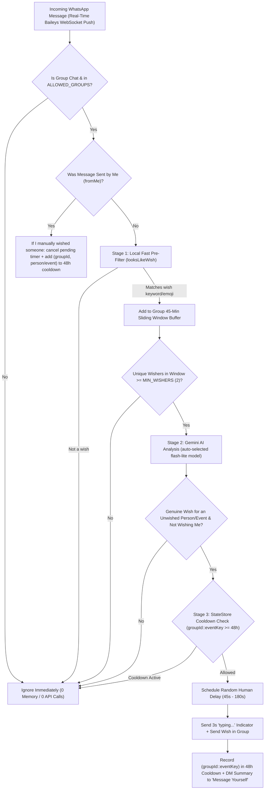

# WhatsApp Group Birthday, Anniversary & Festival Auto-Wish Bot 🎂🎉

A lightweight, 24/7 event-driven WhatsApp group auto-reply bot built with **Node.js**, **`@whiskeysockets/baileys`**, and **Google Gemini (`GEMINI_MODEL=auto`)**.

When multiple people in one of your whitelisted WhatsApp groups wish someone a **Happy Birthday**, **Happy Anniversary**, or celebrate a **Festival** (e.g., Diwali, Saal Mubarak / Nutan Varshabhinandan, Uttarayan, Holi, Eid, Christmas, Navratri, Ganesh Chaturthi), the bot detects the trend in real time, verifies the occasion with Gemini AI, waits a natural human-like delay, sends a warm wish on your behalf, and DMs your own **"Message Yourself"** chat with a summary.

---

## How the Code Works (Architecture & Pipeline)



### Key Capabilities & Safeguards

1. **100% Real-Time Push (Zero Polling) (`src/bot.js`)**
   - Uses `@whiskeysockets/baileys` over WhatsApp's Multi-Device WebSocket protocol (~40MB RAM, no headless Chrome needed).
   - WhatsApp pushes `messages.upsert` events in real time as messages arrive.

2. **Manual Wish Detection & Cooldown (`src/bot.js` & `src/geminiService.js`)**
   - If *you* manually send a wish in a group from your phone (`msg.key.fromMe === true`), the bot:
     1. Cancels any pending countdown timer for that group.
     2. Extracts the person/festival (`extractManualWishKeys`) from your message and recent buffered messages, and adds `(groupId, eventKey)` to the **48-hour cooldown** so it won't wish them again later.

3. **Multiple Birthdays on the Same Day in the Same Group (`src/stateStore.js` & `src/geminiService.js`)**
   - Cooldowns are tracked strictly **per group + per person/event** (`${groupId}::${eventKey}`, e.g., `120363...@g.us::birthday:krunal`) in an auto-pruning in-memory `Map` backed by `data/wish_history.json`.
   - When analyzing a group, the bot passes `alreadyWishedEvents` (everyone already wished in that group within the last 48 hours) to Gemini so it ignores people you already wished today and still wishes a second person whose birthday is on the same day!

4. **Smart `flash-lite` Model Auto-Discovery & Hard Daily Rate Cap (`src/geminiService.js`)**
   - With `GEMINI_MODEL=auto`, `_resolveBestLiteModel()` queries Google's API (`ai.models.list()`) to automatically pick the newest available **`flash-lite`** model (e.g., `gemini-3.5-flash-lite`)—so you never need to update `.env` when models are upgraded or deprecated.
   - Enforces a hard daily cap (`MAX_DAILY_GEMINI_CALLS=20`) and includes a built-in rule-based template fallback if the cap is reached or `GEMINI_API_KEY` is omitted.

5. **Distinct Messages for Birthdays, Anniversaries & Festivals (`src/geminiService.js`)**
   - Classifies each event into `birthday`, `anniversary`, or `festival`, extracts `targetName` (e.g. `"Krunal"`, `"Rahul & Priya"`, `"Diwali"`, `"Saal Mubarak"`), and crafts a tailored reply matching the occasion and group vibe.

6. **Self-Notification DM (`notifySelf` in `src/bot.js`)**
   - Right after wishing in a group, sends a summary message to your own WhatsApp **"You (Message Yourself)"** chat:
     `🤖 Wished Krunal "Happy Birthday @919876543210! Wishing you a wonderful year ahead 🎂🥳" in group chat "MODIYA PARIVAR"`

---

## Project Structure

| File | Responsibility |
| --- | --- |
| `src/index.js` | Application entrypoint and optional HTTP healthcheck server (`PORT`) for cloud hosts. |
| `src/config.js` | Loads and validates environment variables from `.env`. |
| `src/bot.js` | Manages the Baileys WhatsApp socket, group whitelist, manual-wish cooldown, delayed sending, and self-DM notification. |
| `src/wishDetector.js` | Fast regex/emoji wish detector (`looksLikeWish`) and per-group 45-minute sliding-window aggregator (`WishTracker`). |
| `src/geminiService.js` | Auto-discovers the latest `flash-lite` Gemini model, verifies wishes, and generates occasion-specific replies. |
| `src/stateStore.js` | Stores per-group per-person cooldowns (`groupId::eventKey`) in memory and `data/wish_history.json` with 48h auto-pruning. |
| `src/simulate.js` | Local simulation script (`npm run simulate`) to test the full pipeline without sending WhatsApp messages. |
| `tests/wishBot.test.js` | Automated unit tests for wish detection, sliding window, 48-hour per-person cooldowns, and manual wish extraction. |
| `Dockerfile` & `railway.json` | Container and Railway deployment configuration with `/app/data` volume mount. |

---

## Local Usage

```bash
# 1. Install dependencies
npm install

# 2. Run unit tests & local simulation
npm test
npm run simulate

# 3. Start the bot (set DRY_RUN=true in .env for safe dry-run testing, or DRY_RUN=false for live mode)
npm start
```

---

## 24/7 Cloud Deployment on Railway

1. Connect this GitHub repository (`Dhaivat717/birthday_festival_wish_bot_whatsapp`) to your **Railway** service (`whatsapp-wish-bot`).
2. Ensure a persistent **Volume** is mounted at `/app/data` so your WhatsApp login session (`auth_info_baileys`) and 48-hour cooldown history (`wish_history.json`) survive restarts.
3. Configure your Railway service variables:
   - `GEMINI_API_KEY`: Your Google Gemini API key
   - `GEMINI_MODEL`: `auto`
   - `ALLOWED_GROUPS`: Comma-separated group IDs (`...@g.us`) or group names
   - `PAIRING_PHONE_NUMBER`: Your WhatsApp phone number with country code (digits only, e.g. `17325550199`) to receive an 8-digit pairing code in the Railway deploy logs
   - `MIN_WISHERS`: `2`
   - `COOLDOWN_HOURS`: `48`
   - `DRY_RUN`: `false`
